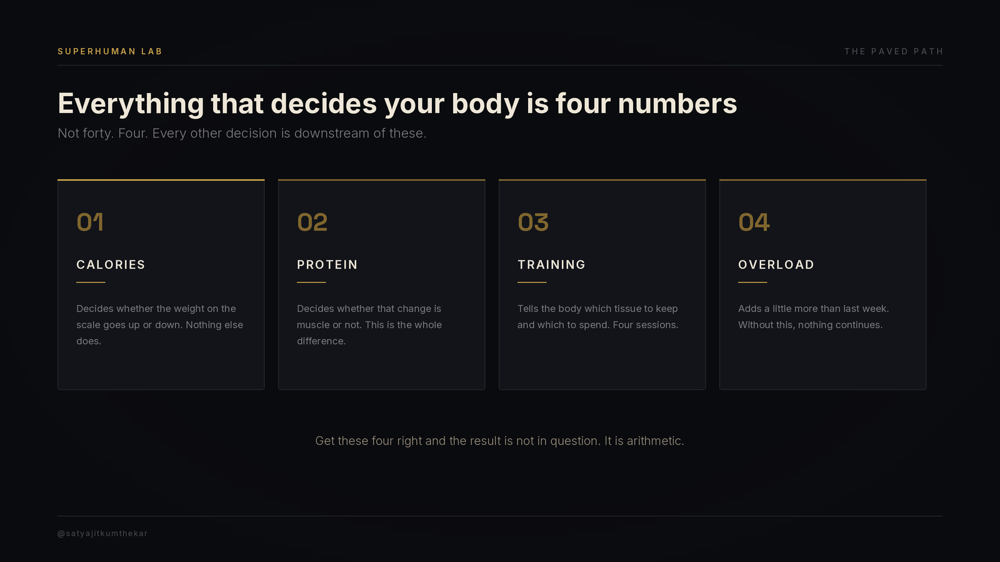

This is everything I coach, on one page. You get the training system, the food system, the way to handle social plans, and the regulation practice that makes all of it stick. It is free, and it takes about seven minutes to read.

Every section starts with what you get out of it. The video guides go deeper. They are the same ones my clients watch, so when I ask you to text me in a video, write it down instead.

By Satya, [**@satyajitkumthekar**](https://www.instagram.com/satyajitkumthekar) on Instagram.

<Card title="Want us to run this with you?" icon="arrow-right" horizontal href="https://docs.google.com/document/d/1N7V3LxY74yB281UcNjnu8MXFvq2-9y1_RQCCw8-k2gU/edit?usp=sharing">
  This kit is the do it yourself version of The Last Piece, my coaching program. Read the offer here.
</Card>

**Jump straight to a section**

<CardGroup cols={2}>
  <Card title="The training system" icon="dumbbell" href="#the-training-system">
    One system and a four day plan you can run for years.
  </Card>

  <Card title="The food system" icon="utensils" href="#the-food-system">
    Two numbers, one anchor meal and meals you can copy.
  </Card>

  <Card title="Social situations" icon="champagne-glasses" href="#social-situations">
    Four questions to ask before any event.
  </Card>

  <Card title="Regulation" icon="brain" href="#regulation">
    The practice that makes all of it stick.
  </Card>
</CardGroup>

## Why nothing has stuck

You already know what to do. Most of the time you are rational and motivated. Then a hard day comes, the logic disappears, and you end up convincing yourself to eat the junk food or skip the workout.

Two things get in the way.

**Your system.** Most plans are built for a transformation, not for a life. They break the first week your life stops looking like the plan.

**Your state.** At the end of a hard day you are dysregulated, and food is the fastest way to feel good again.

This kit fixes both. The first three sections are your system. The last one is your state.

On the system side, only four things decide your body: calories, protein, training and overload. Everything else is noise.

<Frame>
  
</Frame>

## The training system

**What you get.** You stop hopping between programs. You run one system for the next two years, you always know what to do in the gym, and you watch your strength go up in numbers.

Most people stay stuck because they never follow one system for long enough. This is the one I have trained on for three years, and every client of mine is on it. I call it the pyramid training system.

**Every exercise sits on one of three levels.**

| Level | What it is | Examples |
| :-- | :-- | :-- |
| Primary | Compound lifts that show the strength of your whole body. | Bench press, pull ups, barbell rows, squats, RDLs, hip thrusts |
| Secondary | Not fully compound, but they still work your bigger muscles. | Single arm rows, seated shoulder press, chest fly, leg press, quad extensions, leg curls |
| Tertiary | Smaller movements for your smaller muscles. | Lateral raises, bicep curls, tricep extensions, calf raises |

Train in that order in every session, primaries first and tertiaries last. If you tire a small muscle like your triceps first, it gives out before your chest has done any work.

**You train in blocks of 16 weeks.**

<Steps>
  <Step title="Weeks 1 to 8: build muscle">
    Primaries and secondaries sit at 8 to 12 reps. Tertiaries sit at 10 to 12 reps.
  </Step>
  <Step title="Weeks 9 to 16: build strength">
    Primaries drop to 4 to 6 reps, and you lower the weight for 4 seconds on every rep. Secondaries and tertiaries keep their reps, but you change the movement so your body gets a new stimulus. For example, a barbell curl becomes an alternating dumbbell curl.
  </Step>
  <Step title="Then take one week completely off">
    After that, you start the next block. Six blocks cover two years of training.
  </Step>
</Steps>

Never change your primaries. They are how you track your strength.

<Frame caption="Video guide: the pyramid training system, 11 minutes. [Watch it on Loom](https://www.loom.com/share/a09ca47af4784bc3b1945f73cef43780).">
  <iframe className="w-full aspect-video rounded-xl" src="https://www.loom.com/embed/a09ca47af4784bc3b1945f73cef43780" title="The pyramid training system" frameBorder="0" allowFullScreen loading="lazy"></iframe>
</Frame>

**How to train**

- Train each muscle twice a week. Four sessions is enough: upper, lower, rest, upper, lower.
- Feel the muscle before you chase the weight. That takes the right technique, a controlled tempo, and your full attention on the muscle you are working.
- Do three sets of every exercise, and take every set to failure inside its rep range. Failure means you cannot finish another rep with proper form. If you get more reps than the range, go heavier.
- On heavy squats, bench press and deadlifts, stop when your form breaks down.
- Write every set down, and beat last week by one rep or a little more weight.
- When life gets busy, shrink the plan instead of stopping. Downshifting is the plan. It is not falling off.

<AccordionGroup>
  <Accordion title="The four day plan" icon="calendar-days">
    Run it as upper, lower, rest, upper, lower. You repeat the same two workouts, because repetition is how you get good at the lifts.

    **Upper**

    | Level | Exercise | Sets and reps |
    | :-- | :-- | :-- |
    | Primary | Bench press | 3 sets of 8 to 12 |
    | Primary | Pull ups, or lat pulldowns until you can do 8 | 3 sets of 8 to 12 |
    | Secondary | Seated shoulder press | 3 sets of 8 to 12 |
    | Secondary | Single arm row | 3 sets of 8 to 12 |
    | Secondary | Chest fly | 3 sets of 8 to 12 |
    | Tertiary | Lateral raises | 3 sets of 10 to 12 |
    | Tertiary | Bicep curls | 3 sets of 10 to 12 |
    | Tertiary | Tricep pushdowns | 3 sets of 10 to 12 |

    **Lower**

    | Level | Exercise | Sets and reps |
    | :-- | :-- | :-- |
    | Primary | Squats | 3 sets of 8 to 12 |
    | Primary | Romanian deadlifts | 3 sets of 8 to 12 |
    | Secondary | Leg press | 3 sets of 8 to 12 |
    | Secondary | Leg curls | 3 sets of 8 to 12 |
    | Secondary | Quad extensions | 3 sets of 8 to 12 |
    | Tertiary | Standing calf raises | 3 sets of 10 to 12 |
    | Tertiary | Seated calf raises | 3 sets of 10 to 12 |

    Rest about three minutes between sets on your primaries and about 90 seconds on everything else. These are the numbers for weeks 1 to 8. In weeks 9 to 16, your primaries drop to 4 to 6 reps and you swap your secondaries and tertiaries for a new movement.
  </Accordion>

  <Accordion title="Busy week? Run the chaos system" icon="shuffle">
    Your days are chaotic, but your weeks always have a pattern. So plan the week, not the day.

    **The Sunday 10 minute ritual**

    1. Be honest about your week. Look at what is actually on your calendar, not what you hope it will be.
    2. Pick your target. A normal week gets the four day plan. A chaos week gets two full body sessions.
    3. Find the gaps and block them like meetings you cannot move.
    4. Forget about it until the block hits. You made every decision on Sunday.

    **The anchor workout.** Pick one session that happens no matter how bad the week gets. Mine was always Saturday morning.

    **Chaos week: two full body sessions, on any two days**

    | Exercise | Sets and reps |
    | :-- | :-- |
    | Squats | 3 sets of 8 to 12 |
    | Bench press | 3 sets of 8 to 12 |
    | Barbell rows | 3 sets of 8 to 12 |
    | Romanian deadlifts | 3 sets of 8 to 12 |
    | Pull ups or lat pulldowns | 3 sets of 8 to 12 |
    | Seated shoulder press | 3 sets of 8 to 12 |

    **No gym at all: 30 minutes at home, every two days**

    | Exercise | Sets |
    | :-- | :-- |
    | Push ups | 3 sets to failure |
    | Pike push ups | 3 sets to failure |
    | Bodyweight squats or jump squats | 3 sets to failure |
    | Reverse lunges | 3 sets of 12 to 20 on each leg |
    | Glute bridges | 3 sets to failure |
    | Diamond push ups | 2 sets to failure |
    | Plank | 2 holds for as long as you can |

    On these weeks, food has two jobs only. Hit your protein and walk 8,000 steps. Everything else is free.

    The routine adapts. The commitment does not. That is the skill.
  </Accordion>
</AccordionGroup>

## The food system

**What you get.** You stop following meal plans. You know your two numbers, one meal does most of the work, and the rest of your food is yours to choose.

Food has one principle and two numbers.

**The principle.** You lose fat when you eat less energy than you burn. No food is exempt from this.

**Your two numbers.**

<Steps>
  <Step title="Calories">
    Get your maintenance number from a [TDEE calculator](https://tdeecalculator.net/). Take off around 500 to lose fat, or add around 300 to build muscle.
  </Step>
  <Step title="Protein">
    Take your weight in kilograms and multiply it by 2.2. That number, in grams, is your protein for the day. At 80 kg, that is about 175 grams.
  </Step>
</Steps>

Treat it like a budget. Protein is the fixed cost you pay first. Whatever calories are left are yours to spend on the food you love.

**The anchor meal.** Fix one meal a day that packs the most protein into the fewest calories, so it carries most of your protein. For example, 300 grams of Greek yogurt with two scoops of whey gives you about 80 grams of protein for about 560 calories. Build two or three versions of it, and eat it early in the day. Once it is eaten, the rest of your meals are free.

<Frame>
  -1.png "The anchor method")
</Frame>

**Calorie banking.** Your body settles the account over the week, not the day. If Saturday has a wedding, eat a little lighter on the days before it. Bank before the event, never after.

**Check it every two weeks.** Weigh yourself at the same time of day and take the weekly average. If the average has not moved after two weeks and you hit your numbers, change your calories by around 200.

Track your food until you can see your numbers on a plate without an app. The goal is to stop needing to track at all.

<AccordionGroup>
  <Accordion title="Anchor meals you can copy" icon="bowl-food">
    A simple rule is to give your anchor meal about 40 percent of your daily calories. Every option below starts with two scoops of whey, which give you about 50 grams of protein for about 250 calories.

    | Your anchor meal budget | Non veg | Veg |
    | :-- | :-- | :-- |
    | 500 to 600 calories | Two scoops of whey, 150 g of grilled chicken and a big salad. That is about 80 g of protein. | Two scoops of whey stirred into 300 g of Greek yogurt, with 200 g of low fat cottage cheese and berries. That is about 95 g of protein. |
    | 700 to 800 calories | Two scoops of whey, 200 g of grilled chicken, two whole eggs and a salad. That is about 105 g of protein. | Two scoops of whey stirred into 300 g of Greek yogurt, with 200 g of low fat paneer and a salad. That is about 110 g of protein. |
    | 900 to 1,000 calories | Two scoops of whey in milk, 300 g of chicken, three whole eggs and a salad. That is about 140 g of protein. | Two scoops of whey in milk, 400 g of firm tofu, 300 g of Greek yogurt and a salad. That is about 120 g of protein. |

    You do not need a new meal every day. Pick one or two that fit your budget and taste good to you, and repeat them.
  </Accordion>

  <Accordion title="What the rest of your budget buys" icon="ticket">
    The calories left after your anchor meal are your fun coupons. Spend them on whatever you want. Here is roughly what they buy.

    | Everyday food | Calories |
    | :-- | :-- |
    | Chai with milk, 200 ml | 80 |
    | One banana | 90 |
    | One whole wheat roti | 100 |
    | One medium bowl of sabzi, light oil | 130 |
    | Two scrambled eggs, no oil | 140 |
    | A handful of almonds, 25 g | 145 |
    | One cup of dal, no tempering | 150 |
    | One cup of cooked rice | 200 |

    | Treat | Calories |
    | :-- | :-- |
    | One beer, 330 ml | 150 |
    | One scoop of ice cream | 200 |
    | One masala dosa | 200 |
    | One small chocolate bar, 40 g | 220 |
    | One samosa | 250 |
    | One slice of pizza | 280 |
    | One vada pav | 320 |
    | One small bowl of biryani, 250 g | 350 |

    Say your day is 2,500 calories and your anchor meal takes 1,000. A chai, a roti, a bowl of dal, a beer and a scoop of ice cream all fit, with room to spare.
  </Accordion>
</AccordionGroup>

## Social situations

**What you get.** A clear way to decide on every dinner, wedding and night out, with no guilt either way. It also shows you exactly where you break, so you know what to work on.

Ask yourself four questions before the event.

<Steps>
  <Step title="Do I actually want to involve myself in this?">
    This means the food and the drinks, not just the event. If the answer is no, ask why you still feel compelled. It is usually the fear of letting someone down, or a tough conversation that you are avoiding.
  </Step>
  <Step title="Can I make space for it?">
    Eat your anchor meal early and keep the rest of the day light, so you have calories left to spend at the event.
  </Step>
  <Step title="Is it worth it?">
    Making space means sitting with some hunger during the day. If the event is worth that, do it and enjoy the event. If it is not, say clearly that you are not eating or drinking, and go for the people.
  </Step>
  <Step title="What feels more aligned?">
    Sometimes you cannot make enough space. Then you either fully indulge because the event matters that much, like your best friend's wedding, or you enjoy what you made space for and let the rest go. There is no right or wrong here. There is only your right and your wrong.
  </Step>
</Steps>

If you did not follow through, ask one question afterwards. Which emotion did I give in to?

- If it was your own discomfort, like a craving, stress or boredom, the work is regulation.
- If it was the fear of disappointing someone, the work is your tolerance for people pleasing.
- If you could never create enough space, the work is more flexibility with your food.

<Frame caption="Video guide: Social situations 101, 11 minutes. [Watch it on Loom](https://www.loom.com/share/3129320e5a9747b3b9ba21909ef36788).">
  <iframe className="w-full aspect-video rounded-xl" src="https://www.loom.com/embed/3129320e5a9747b3b9ba21909ef36788" title="Social situations 101" frameBorder="0" allowFullScreen loading="lazy"></iframe>
</Frame>

## Regulation

Everything above only works if you can follow it on a hard day, and that depends on your state.

You are dysregulated when you are in a state you want to escape. Food is the fastest escape, which is why the plan breaks at the end of a hard day. The system above gives you room for dessert. Regulation is what makes you stop needing it. It has three parts.

<Steps>
  <Step title="Aware">
    **What you get.** You catch the state before it makes the decision for you. You cannot regulate a state you have not noticed.

    Catch yourself once or twice a day and write down four things: the emotion, how your body is reacting, the thoughts, and the trigger. If you cannot catch it in the moment, do it in a morning journal. The same few triggers will keep coming up. You are ready for the next part when you can name the state behind most of your slips.

    <Frame caption="Video guide: being aware of your brain and body state, 18 minutes. [Watch it on Loom](https://www.loom.com/share/0c4cffd9e0ac4f5aa76f9d7b4dc791ae).">
      <iframe className="w-full aspect-video rounded-xl" src="https://www.loom.com/embed/0c4cffd9e0ac4f5aa76f9d7b4dc791ae" title="Being aware of your brain and body state" frameBorder="0" allowFullScreen loading="lazy"></iframe>
    </Frame>
  </Step>
  <Step title="Regulate">
    **What you get.** Hard days hit softer, and your normal days get calmer too. Once you know what regulated feels like, you start to want it more than the escape.

    Run three moves, in this order.

    1. **Come into the present.** Close your eyes and listen. Add your breath, then the feeling on your skin. Then open your eyes and look around. Tell yourself, "This is the only moment."
    2. **Zoom out.** Look up at the sky and picture yourself as a small dot. Tell yourself, "It's just a game. I'm a grain of sand."
    3. **Own it.** How you feel is conditioning, and you can change it. Tell yourself, "I am responsible."

    Practise the whole thing for 10 minutes a day while you are calm. In a hard moment, run the same three moves in about two minutes.

    <Frame caption="Video guide: the regulation practice, 25 minutes. [Watch it on Loom](https://www.loom.com/share/43107b9407c24862b1d6490daed5b64d).">
      <iframe className="w-full aspect-video rounded-xl" src="https://www.loom.com/embed/43107b9407c24862b1d6490daed5b64d" title="The regulation practice" frameBorder="0" allowFullScreen loading="lazy"></iframe>
    </Frame>
  </Step>
  <Step title="Reflect">
    **What you get.** Your mind learns what breaking a promise costs and what keeping it gives you, so the next choice gets easier.

    After a promise you keep or break, take six minutes. For the first three, feel it and name the exact feeling. For the next three, ask why, three times. Do this for the wins as well as the losses.
  </Step>
</Steps>

Do this daily, and a hard day stops deciding what you eat and whether you train.

## The Last Piece

You now have the whole system. Used with sincerity, it works.

If you want us to run it with you, that is The Last Piece, my coaching program. A coach works with you day to day on your training and food habits. I design your program, and you join my weekly group calls.

<Card title="Enrol in The Last Piece" icon="file-lines" horizontal href="https://docs.google.com/document/d/1N7V3LxY74yB281UcNjnu8MXFvq2-9y1_RQCCw8-k2gU/edit?usp=sharing">
  Read the full offer: what it is, what you get, and how to join. It is a 10 minute read.
</Card>

<CardGroup cols={2}>
  <Card title="See the results" icon="instagram" iconType="brands" href="https://www.instagram.com/superhumanlab.fit">
    Client results and testimonials are at @superhumanlab.fit.
  </Card>

  <Card title="Find me on Instagram" icon="instagram" iconType="brands" href="https://www.instagram.com/satyajitkumthekar">
    Follow or message me at @satyajitkumthekar.
  </Card>
</CardGroup>
